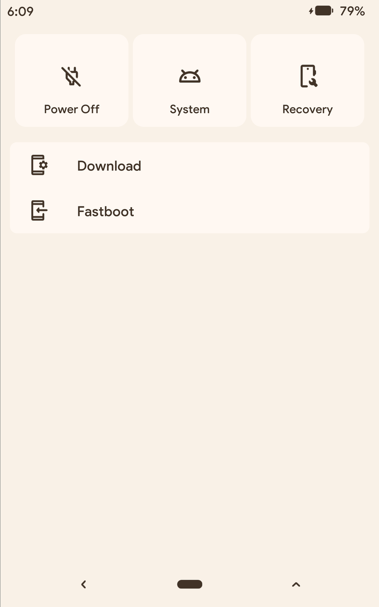
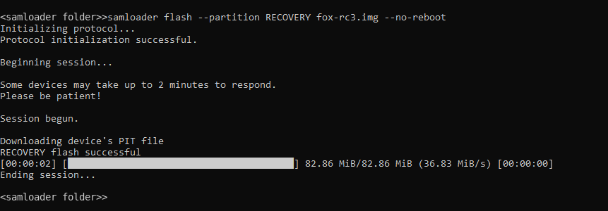
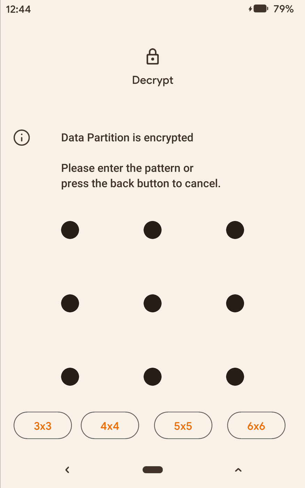
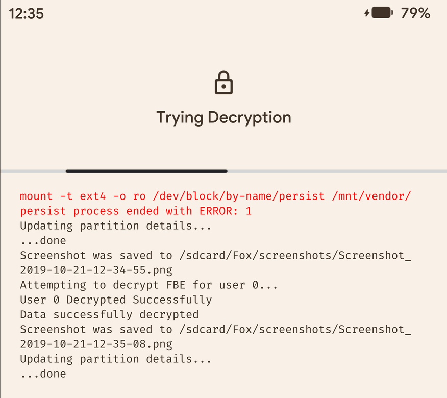
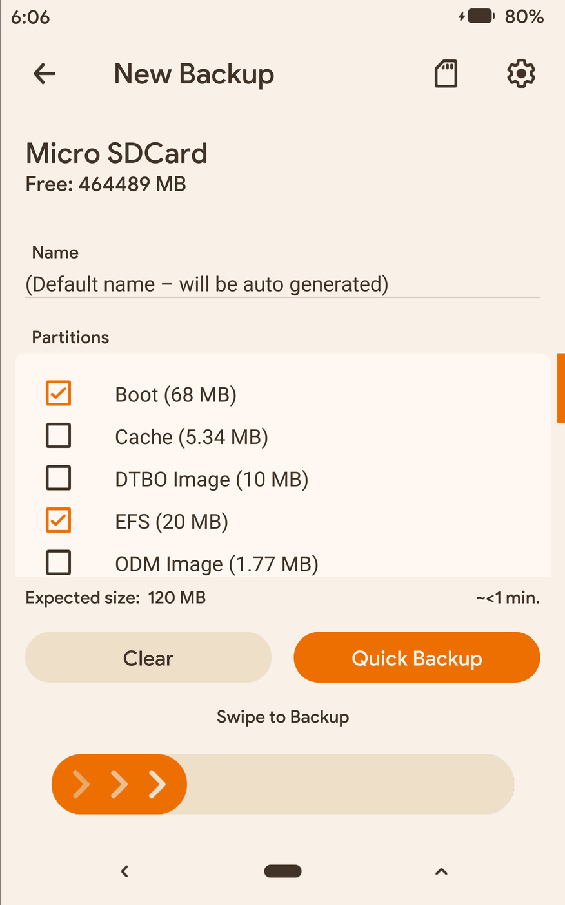
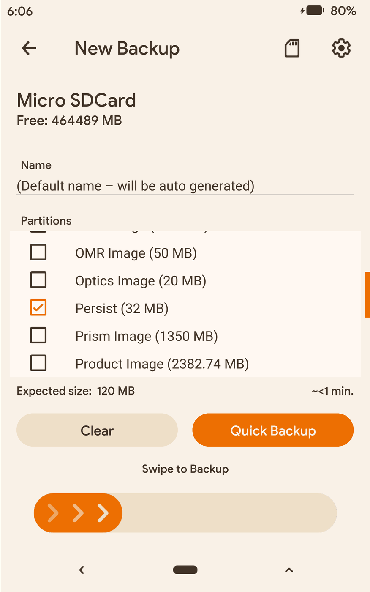
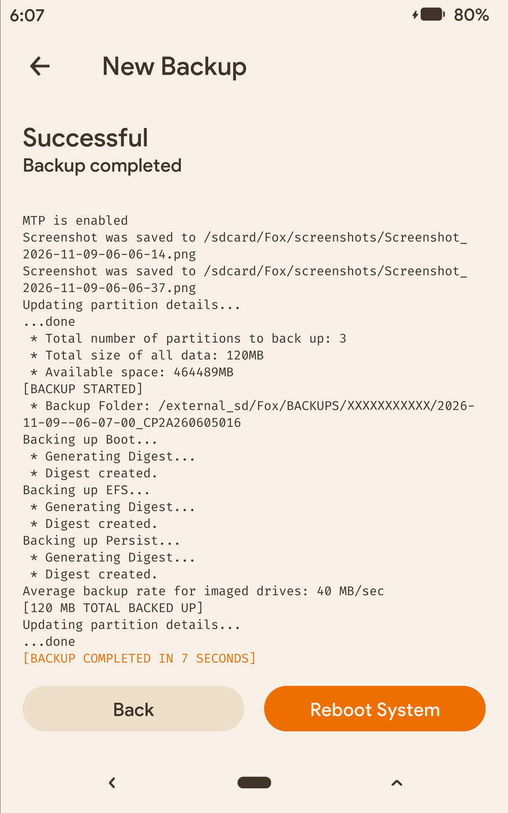
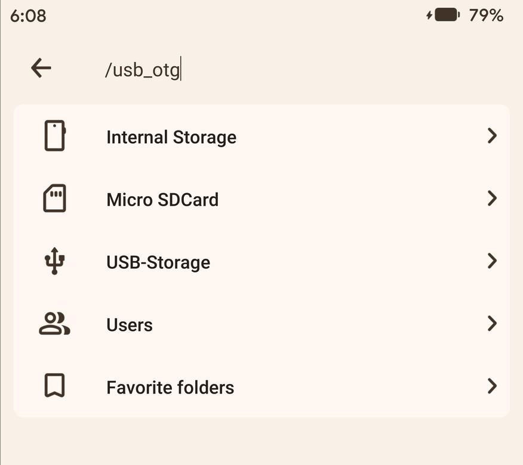
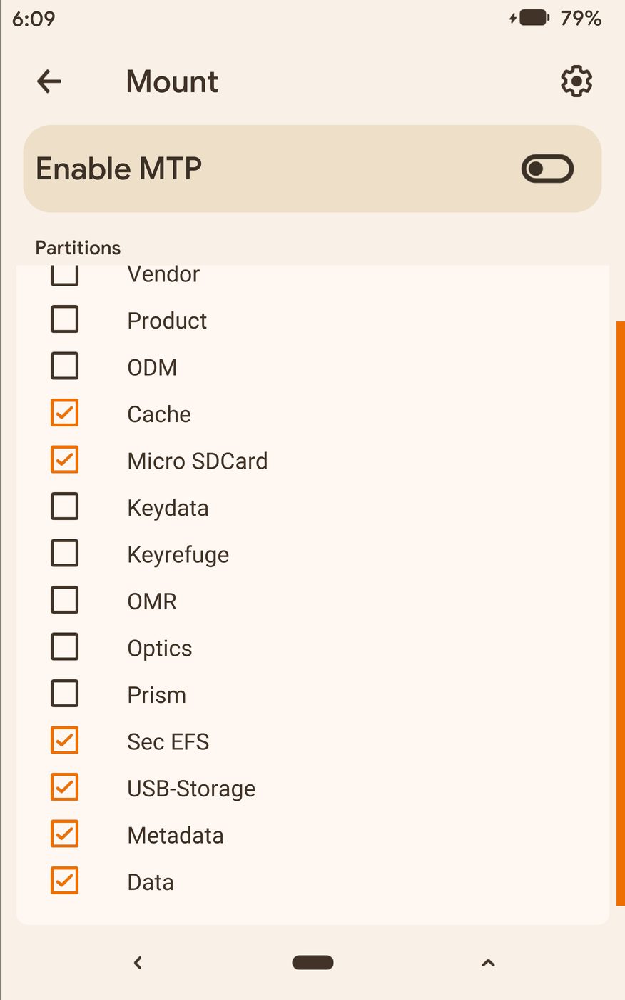

# gts7xlwifi-orangefox

OrangeFox R12.0 (fox_12.1) for the Samsung Galaxy Tab S7+ Wi-Fi, SM-T970 (`gts7xlwifi`), with
`/data` decryption on LineageOS 24.0 (Android 17). Built on JeyKul's TWRP 12.1 tree
(`android_device_samsung_gts7lwifi-twrp`, branch `android-12.1`), which goes back to the TeamWin
trees for the Galaxy A52s 5G and S20 FE; the git history of those trees is kept. See
[NOTICE](NOTICE).

Tested build, test results and known gaps: [test-notes.md](test-notes.md). Every release carries
its own `TEST-NOTES.md`.

Discussion and feedback:
[XDA thread](https://xdaforums.com/t/recovery-unofficial-orangefox-r12-0-for-galaxy-tab-s7-wi-fi-sm-t970-gts7xlwifi-with-data-decryption-on-lineageos-24.4808070/).
Bug reports are welcome there or as GitHub issues. `/tmp/recovery.log` helps, but after a
decrypting session it can contain the pattern or password that was entered: remove it before
posting the log.

## What works

- Decryption of FBE v2 with metadata encryption, and the lock screen credential: the QSEE
  keymaster, and the gatekeeper through the MDFPP module (`gatekeeper.mdfpp.so`), the instance
  LineageOS itself uses on this tablet.
- After a decrypting session Android starts and unlocks `/data` as before, and its
  `misc_ce/0/checkin` directory keeps its SELinux level (see [patches/](patches/README.md)).
- ADB, MTP (Windows Explorer, files copied), brightness, the console overlay, the Files menu.
- microSD: an exFAT card of 1 TB was mounted and used for backups.
- Backups of Boot, EFS and Persist. EFS and Persist are backed up as raw images
  (`efs_image.emmc.win`, `persist_image.emmc.win`).
- USB-OTG: a card reader behind a USB-C hub was mounted at `/usb_otg` and is listed as USB storage
  in the Files menu. The tablet has one USB-C port, so while the hub is attached there is no ADB
  or MTP from a computer on that port.

Not tested yet: restoring a backup, Format Data, installing a ROM or an update from OrangeFox,
Odin, the OrangeFox `.zip`, FAT32 and NTFS storage, other LineageOS builds. The full list is in
[test-notes.md](test-notes.md).

## Read this before flashing

- **SM-T970 only.** The LTE and 5G models (SM-T975, SM-T976B) are other devices and were not
  tested.
- **Tested on LineageOS 24.0** (`24.0-20261029-nightly`). The recovery reports placeholder values
  (Android 99.87.36, security patch 2127-12-31), as many TWRP and OrangeFox trees do. On this
  tablet, with this ROM, that was measured to work: `/data` decrypts, and Android unlocks it again
  afterwards. On the Xiaomi and Google devices of the other `Gursu-Bilisim` OrangeFox trees the
  recovery must report the ROM's own values instead. Before flashing, compare the image with the
  `boot.img` of the LineageOS build you run (from its zip):
  `patch-check.ps1 -BootImg <boot.img> -RecoveryImg <OrangeFox .img>`. A green
  `RESULT: match` means the values were measured on this device.
- The bootloader must be unlocked and the LineageOS `vbmeta.img` installed, as in the LineageOS
  installation guide. A tablet that runs LineageOS already has both.
- Keep the Lineage Recovery image of your build (`recovery.img` from the LineageOS download page)
  to go back.
- Do not use Fix Contexts or other functions that relabel `/data`. The recovery's Android 12
  SELinux library does not know the per-user levels of newer Android versions; this is why the
  automatic `restorecon` in vold was removed (see [patches/](patches/README.md)).

## Installing

### Step 1: Download mode

One of:

- From Android, with USB debugging on: `adb reboot download`
- From Android: the power menu's restart options, Download mode (needs Advanced restart turned on
  in the LineageOS settings).
- From OrangeFox: Menu (bottom right), then the reboot options, Download (picture below).
- With the keys: power the tablet off, connect the USB cable, then hold Volume Up + Volume Down
  + Power. A warning screen appears; press Volume Up once to continue.

Entered with `adb` or from a menu, the tablet goes straight to the Download mode screen without
the warning. After the key combination the computer only sees the tablet once Volume Up has been
pressed on the warning screen.



### Step 2: flash the recovery

[samloader-rs](https://github.com/topjohnwu/samloader-rs/releases/latest) is the tool the
LineageOS guide uses for this tablet. In a Command Prompt or PowerShell window, in the folder with
`samloader.exe` and the image:

```
samloader flash --partition RECOVERY OrangeFox-gts7xlwifi-<tag>-los24.img --no-reboot
```

A transfer bar appears on the tablet. The screen keeps showing `Downloading... Do not turn off
target!!` after the transfer has finished. On the computer:



Odin (AP slot, the release `.tar`, Auto Reboot off) should do the same, but was not tested.

### Step 3: start the recovery

One of:

- From Download mode: hold Volume Down + Power until the screen turns black, release the keys
  at once, then hold Volume Up + Power until the recovery starts.
- From Android, with USB debugging on: `adb reboot recovery`
- From Android: the power menu's restart options, Recovery (needs Advanced restart).

Starting Android first is fine: on the test tablet LineageOS did not replace OrangeFox, and the
recovery was then started with `adb reboot recovery`.

When the recovery is entered with the keys, the screen may stay dark on the pattern page: the
Power key was still held while the recovery started. Press Power once to turn the screen on.
With `adb reboot recovery` this does not happen.

### Step 4: decrypt

Draw the lock screen pattern. After it is accepted the console shows a red line:

```
mount -t ext4 -o ro /dev/block/by-name/persist /mnt/vendor/persist process ended with ERROR: 1
```




`persist` is already mounted at that place; the message has no effect. It comes from the shared
OrangeFox patch made for another device (see [patches/README.md](patches/README.md)).

### From a running OrangeFox (not tested)

- Install the release `.zip`.
- Or Install, Install Image, select the release `.img`, then Recovery.

## Backups

EFS (`/dev/block/by-name/efs`, 20 MB) and Persist (32 MB) are backed up as raw images. They hold
device-specific data; keep their backup with the device, and restore it only to the same tablet.
Restoring was not tested.

1. Backups (bottom bar), New Backup. The storage icon at the top right chooses Micro SDCard,
   Internal Storage or USB-Storage.
2. Tick Boot and EFS, scroll down and tick Persist (or the partitions you need).
3. Swipe to Backup.





Backups go to `Fox/BACKUPS/<serial number>/` on the selected storage (masked in the picture),
one `.emmc.win` image and one `.sha2` file per partition.

## USB storage

The SD card is mounted at `/external_sd` and listed as Micro SDCard; a USB stick or card reader at
`/usb_otg`, listed as USB-Storage in the Files menu (opened from the path field at the top of the
file list) and on the Mount page. The tested card reader was attached through a USB-C hub and held an exFAT
card. While the hub is attached the port is in host mode: there is no ADB or MTP from a computer
until the hub is removed.




## Building

1. Sync OrangeFox `fox_12.1` (see the OrangeFox wiki) into `<OrangeFox source tree>`.
2. Clone this repository to `<OrangeFox source tree>/device/samsung/gts7xlwifi`.
3. Apply the two patches in [patches/](patches/README.md) (`bootable/recovery` and
   `system/vold`).
4. Build:

```bash
cd <OrangeFox source tree>
source build/envsetup.sh
export ALLOW_MISSING_DEPENDENCIES=true FOX_BUILD_DEVICE=gts7xlwifi
lunch twrp_gts7xlwifi-eng
mka adbd recoveryimage
```

Run the commands on separate lines: `source build/envsetup.sh` can return a non-zero status, so
a chain joined with `&&` stops after it.

The output is `out/target/product/gts7xlwifi/OrangeFox-*-gts7xlwifi.img`, `.img.tar` and `.zip`.

On an incremental build, TWRP's `relink_libraries` step does not copy a rebuilt
`libminuitwrp.so` into the ramdisk, so the image keeps the old library. After a change to
`bootable/recovery/minuitwrp`, build it on its own and copy it before packing:

```bash
mka adbd libminuitwrp
cp out/target/product/gts7xlwifi/system/lib64/libminuitwrp.so \
   out/target/product/gts7xlwifi/recovery/root/system/lib64/
mka recoveryimage
```

`recovery-inspect.ps1` reports an old library under "Display".

### Notes on the tree

- Kernel, DTB and recovery DTBO come from the LineageOS 24.0 `recovery.img` of this tablet
  (4.19.325-cip136). JeyKul's tree carried the parts of the Tab S7 (SM-T870: LCD panel, Novatek
  touch, 1600x2560). The kernel is stored gzip-compressed: uncompressed, the image was 3.6 MB
  larger than the RECOVERY partition (86888448 bytes).
- The framebuffer is landscape (2800x1752) and OrangeFox has a portrait theme only:
  `TW_ROTATION := 270`. The console crash fixed in `patches/bootable_recovery.diff` appeared only
  with this rotation.
- `recovery/root/init.recovery.qcom.rc` keeps `persist` and `efs` mounted at `/mnt/vendor` until
  `twrp.all.users.decrypted=true`; `sec_nvm` needs them while the pattern is checked.
- `recovery/root/vendor/etc/ueventd.rc` is LineageOS's `ueventd.qcom.rc`; without it the SPU
  devices are `root 0600` and `qseecomd` cannot reach them.
- In `twrp.flags`, partitions are named at the root level (`/efs_image`, `/persist_image`,
  `/usb_otg`): TWRP finds a partition by the first part of its path, so `/mnt/vendor/efs` could
  not be backed up, and the OrangeFox Files menu shows USB storage only for `/usb_otg`.

## Tools

### recovery-inspect.ps1

Lists what an OrangeFox image contains, without flashing it. The same script is shared by the
`Gursu-Bilisim` OrangeFox repositories: it reads the device from the image's `prop.default` and
runs that device's checks; images of other devices get the common checks. For gts7xlwifi it
checks the image layout and size, the `twrp.flags` entries above, and the decryption chain
(qcom decrypt init, `ueventd.rc`, `qseecomd`, keymaster, gatekeeper, `spdaemon`, `sec_nvm`,
`gatekeeper.mdfpp.so`, the vold change). Accepts the `.img`, the Odin `.tar` or the OrangeFox
`.zip`. Works in Windows PowerShell 5.1 and PowerShell 7.

```
powershell -ExecutionPolicy Bypass -File recovery-inspect.ps1 -Img 
```

### patch-check.ps1

Compares the recovery with the ROM: the `/data` line of both fstabs (fscrypt version, metadata
encryption) and the Android version and security patch they report.

```
powershell -ExecutionPolicy Bypass -File patch-check.ps1 -BootImg <ROM boot.img> -RecoveryImg 
```

The LineageOS zip for this tablet holds `boot.img` at its root, so `-Zip <LineageOS zip>` works
too.

### release.sh

Publishes the latest build as a GitHub release: image, Odin tar, zip, both scripts,
`TEST-NOTES.md` and `SHA256SUMS`. It stops if `test-notes.md` is older than the image, if the
image's SHA-256 is not recorded in `test-notes.md`, or if `bootable/recovery` or `system/vold` no
longer match the diffs in `patches/`. `./release.sh r2` adds a suffix for a second release on the
same day; `FOX_TREE=<OrangeFox source tree> ./release.sh` if the build is not three folders above
the device tree.

## Credits and license

Built with the work of BlackMesa123, ata-kaner, JeyKul, TeamWin, OrangeFox, LineageOS and the
sources listed in [NOTICE](NOTICE). Written with the help of Claude (Anthropic).

- Files written for this repository: Apache License 2.0 ([LICENSE](LICENSE)).
- Changes to OrangeFox/TWRP: GPL-3.0-or-later; changes to vold: Apache License 2.0; both in
  [patches/](patches/).
- The prebuilt kernel, DTB and DTBO: GPL-2.0, see NOTICE for the source.
- Proprietary vendor files in `recovery/root`: see NOTICE.
